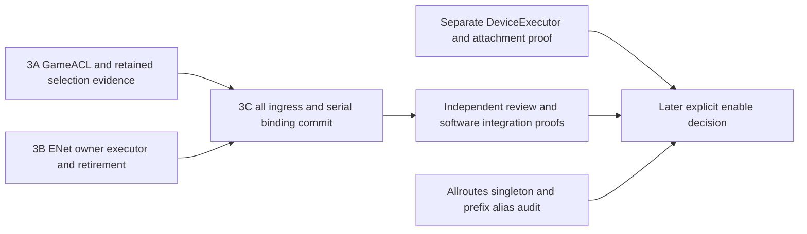

# MWOW-9 — Stage3: ingress inventory и план, runtime disabled

Read-only checkpoint на **e1100bc7673d365058a88c7b21aa4e876a08518e**,
tree `f53e437b0d81367d17721bc5775356c84734cc37`. Manager принял disabled Stage2;
это не приёмка Stage3, deployment или physical input. Здесь только проектирование.
Роль game-complex; уверенность98% в source inventory/направлении,99% в hash evidence.
Все предлагаемые интерфейсы ниже **ещё не реализованы**. Новый production scope требует назначения.

Нормативны текущие project `docs/requirements.md:35–47`, `docs/decisions.md:41–61`
и raw user choices: PadOnly, выбор уже работающей игры заранее разрешённым клиентом;
HUD touch преобразуется в gamepad. WoW не запускать без нового явного разрешения,
текущие game/prefix не трогать. Будущие physical checks — local games после software gates.
Никаких устройств, игр, listeners, builds, system changes или новых агентов в этом checkpoint.

## 1. Pinned inventory: текущий путь и требуемая граница

Все `src/...` ссылки/строки ниже относятся к base выше, не к upstream main.
Полные SHA256 **каждого** файла, ranges, ENet pin и нормативные docs hashes сохранены в
[inventory.json](/home/bazzoozza/.bb/thread-storage/thr_z5wceyp8m4/checks/stage3-plan/inventory.json),
точные numbered excerpts — [source-ranges.txt](/home/bazzoozza/.bb/thread-storage/thr_z5wceyp8m4/checks/stage3-plan/source-ranges.txt).
Это source evidence, не выполненные тесты. AST с explicit project_root: index absent;
reindex не запускался. `tools/agents/manifest.json` отсутствует. В таблице `s/` = `src/moonlight-server/`.

| Ingress / source ranges | Сейчас | Для protected L |
|---|---|---|
| HTTPS identity: `s/rest/servers.cpp:98–181`, `s/state/config.hpp:42–75` | exact paired cert verification; numeric client ID — hash PEM; все paired видят app list | Pin principal по полному DER leaf; GameACL отдельно, numeric hash только индекс с collision refusal |
| Pair/unpair/settings: `s/api/endpoints.cpp:34–83,598–636`, `s/rest/servers.cpp:58–66`, `s/state/configTOML.cpp:410–470` | изменения pairing/config atoms | unpair/ACL/binding edits сначала serial revoke соответствующей authority generation, потом публикация config; pairing не выдаёт GameACL |
| serverinfo/applist/appasset: `s/rest/endpoints.hpp:52–83,345–389` | busy/currentgame по текущему client session; list без client filter | показывать разрешённый stable catalog appid; не выдавать T чужую S identity; appasset не выдаёт launch permission |
| launch/resume: `s/rest/endpoints.hpp:429–504` | launch проверяет session только того же client; resume заменяет snapshot, затем StopStream | protected selection готовит candidate к уже retained L; не StreamSession runner start, не swap старого до exact revoke/ticket |
| cancel: `s/rest/endpoints.hpp:507–527` | GameStopRequest captured source RunScope | отдельное stop authority; передача никогда не вызывает cancel/GameStop. Предлагаемый default — deny protected game stop через remote cancel, см.§7 |
| RTSP association: `s/rtsp/net.hpp:62–121` | fake-IP/Host либо IP lookup на каждый request | capture candidate один раз, exact current revision recheck; IP/echo не authentication, no fallback to replacement/new grant |
| DESCRIBE/ANNOUNCE/PLAY: `s/rtsp/commands.hpp:1–66,165–305` | ANNOUNCE fixes crypto, fires Video+Audio immediately; PLAY returns OK | разделить negotiation/staged descriptors и actual admitted consumers; no pipeline before joint grant |
| ENet CONNECT/current: `s/control/control.cpp:92–110,126–158,196–243` | raw peer only loop; token selects session; CONNECT unauthenticated, forget on disconnect | fresh PeerToken на каждую реальную allocation/connect, exact candidate; transport retirement уведомляет только связанный grant/peer |
| Decrypt/dispatch: `s/control/control.cpp:248–293` | tag/framing/fields/replay, owner selection, Resume, direct handle_input | сохранить guards; authenticated packet доказывает ключ candidate, не выбор игры/transfer. Protected dispatcher получает captured binding/grant |
| Frame validation: `src/moonlight-protocol/moonlight/control.hpp:425–519`; `s/control/input_handler.hpp:16–40` | bounded bytes и typed adapter; wire slots0..15 | те же checks до protected policy; no pointer-only/freshlookup authority |
| Arrival: `s/control/input_handler.cpp:21–213,636–652` | создаёт Xbox/PS/Switch, installs callbacks, emits Plug | selected arrival — только metadata validation; не create/recreate; reject unselected/pad extensions |
| Multi/mask: `s/control/input_handler.cpp:654–705` | lazy-create, mask unplug, setters; UI combo | selected full snapshot→SeatCommand; inactive selected mask→zero frame через тот же FIFO без pressed fallthrough; device/grant сохраняются |
| Mouse all5 forms/buttons; keys/modifiers/text: `s/control/input_handler.cpp:278–497,748–767,789–793` | Wayland или input backend, modifier bookkeeping, combo | deny ДО helper/backend/modifier mutation на обоих ingress; empty held set не inventory proof |
| Raw touch/pen: `s/control/input_handler.cpp:220–277,498–635,768–773` | lazy device creation + Wayland/inputtino setters | deny до любой allocation/Plug; HUD gamepad packets остаются допустимыми |
| Controller touch/motion/battery/HAPTICS: `s/control/input_handler.cpp:708–800`; `input_dispatch.hpp:16–89` | PS dispatch, HAPTICS no-op | explicit Unsupported в protected route; generic MWOW6 field guards не урезать |
| UI combo: `s/control/input_handler.cpp:437–439,692–697`; `s/sessions/lobbies.cpp:640–645` | keyboard/pad combo → explicit Leave | protected pad buttons можно передать игре, но не emit legacy Leave/UI action; новый UI только после Penpot |
| Unix input: `s/api/endpoints.cpp:382–400`, `api.hpp:117–122` | session_id lookup→hex→тот же handle_input, пустой sender | defaultdeny protected; будущая delegation только к уже exact существующему grant, не new takeover endpoint |
| Unix sessions add/start/pause/stop: `s/api/endpoints.cpp:210–400` | dummy/selected client, app/default runner; start fires media; pause/stop capture scopes | protected add/start deny без trusted admission; pause exact capability; game stop отдельно; old request не получает grant через поздний ID lookup |
| Unix profile/app mutation/runner start: `s/api/endpoints.cpp:91–208,574–590` | app/profile/runner descriptors изменяемы, arbitrary runner path | protected GameKey/app binding immutable during run; reject conflict/alias; arbitrary runner/prefix routes — отдельный allroutes gate, не обойти ACL |
| Lobby create/join: `s/api/endpoints.cpp:415–534`; `s/sessions/lobbies.cpp:395–487`; `lifecycle.hpp:244–261` | PIN+single-user cap; device migration, retained members, Wayland wrappers, SwitchProducer | PIN не GameACL; новый reserved handoff binding, не обычный Join в занятый single-user lobby |
| Leave/Stop/UI/RunEnded: `s/sessions/lobbies.cpp:13–80,490–645` | migration back, optional stop_when_empty, membership cleanup | transfer не Leave; exact old notifications cannot remove new binding; explicit L stop закрывает authority до teardown; preserve Unknown |
| Device relays: `s/sessions/moonlight.cpp:62–73`; `lobbies.cpp:548–591`; `state/sessions.hpp:80–128` | F7 exact retained source run + projection, ownqueue suppression | сохранить guard для legacy; protected pad принадлежит L, source events не мигрируют/удаляют его; target-aware denial на relays |
| StreamSession/StartRunner: `s/sessions/moonlight.cpp:75–238` | producers, fallback mouse/keyboard, Wayland mouse/key/touch at159–169, runner | transport-only S/T не fire этот event; fresh protected factory запрещает nonpad creators ещё до publication |
| Consumers/commands/RTP: `s/sessions/moonlight.cpp:241–299`; `streaming/consumer_events.*`; `state/sessions.hpp:104–114` | private real Runtime; exact revoke; F6 producer selection before/after ping | один retained Runtime shared с coordinator; protected Audio/Video только admit_prepared; IDR/Switch captured scope/binding; ping не permission |
| Feedback: `s/control/control.cpp:75–88,135–219`; `input_handler.cpp:27–55,171–192` | weak sender queue256, V2 encrypt/send on loop; enqueue return не retirement | protected stable router+PeerToken, one reservation near actual encrypt/send, packet retirement fence (§4) |
| Startup/shutdown: `s/wolf.cpp:189–227,254–282` | handlers before listeners; detached ingress loops; explicit Run stop | shared protected runtime owner до HTTP/HTTPS/RTSP/control/RTP/Unix; owned ENet shutdown/retirement contract prerequisite |
| Physical attach/runner aliases: `s/runners/docker.cpp:237–310`; `sessions/common.cpp:9–84`; `runners/process.cpp:13–80` | queue/synchronous exec, no checked attach ticket; process runner separate path | plug event/HTTP accepted не readiness; separate bounded DeviceExecutor и singleton/prefix accounting до enable |

## 2. GameACL и stable authority: минимальный контракт

Предлагаем operator-owned configuration, без нового public endpoint/UI: `ProtectedGameSpec`
с stable `GameKey`, существующим catalog appid, `mode=ProtectedPadOnly`, selected_slot0..15
(default0), explicit allowed **DER leaf fingerprints** + collision-safe full-leaf resolution,
и отдельным local operator stop authority. Empty/missing ACL deny; wildcard/pair-all отсутствует.
PEM hash `get_client_id()` не persistent permission ID. Cert replacement даже с тем же key
требует нового разрешения. Existing pairing verification сохраняется, ACL не заменяет TLS.

Catalog appid выбирает configured GameKey; retained registry содержит ровно один current
`ProtectedRun {GameKey, L, lifecycle_revision, shared SeatDomain/Seat/Coordinator/Runtime}`,
включая Unknown. Записи не создаются на основании input/PIN; новый T не создаёт второй game.
Fresh protected provisioning — отдельная операция с проверкой inventory/device attachment.
Уже запущенный legacy WoW нельзя объявить fresh protected; это план будущего режима,
не разрешение переноса/рестарта текущей игры. Имена/title/prefix paths не authority.

Предлагаемые internal types (не wire structs):

- `VerifiedPrincipal`: retained exact leaf identity, создана только TLS verifier/trusted test seam.
- `AccessSnapshot {AuthRevision, GameKey, allowed_principals}`; `check_selection` возвращает
  immutable evidence, **не** разрешение самостоятельно вызвать runner/input.
- `PreparedBinding {source S/T, ConnectionScope, destination L, BindingRevision,
  AuthRevision, prepared transport correlation, lifecycle revision}`. Strong allocation IDs;
  null/old/replaced objects failclosed. Нет public generation fields.
- `SelectionIntent`: server-minted transaction identity после HTTPS `/launch(appid)` либо
  `/resume` exact existing client binding; bounded one pending per L, duplicate identity same
  handle, competing Busy. Duplicate wire request не угадывает identity по одному client ID.
- `PeerBinding {PeerToken, captured ConnectionScope, crypto-state, principal, selected intent}`:
  только owner thread связывает raw ENet allocation; key proof не создаёт SelectionIntent.
- `DelegatedInput`: optional trusted local handle к exact **существующему** grant/peer/binding,
  ограниченному pad/slot; expiry/revoke. Текущий Unix wire contract этого не имеет — deny.

Нужна минимальная будущая serial authority operation в Seat/coordinator: изменение
AuthRevision/target binding/lifecycle close и revoke pending/current выполняются в том же
gate, где commit grant; не «store revoked flag после poll». Подготовка immutable state/ACL
вне lock, swap внутри, destruction старых captures вне lock по F12. Callback validate
читает только уже prepared immutable/current facts, без nested registry lock/IO/reentry.
Auth removal сначала закрывает admissions в serial domain; config публикация затем не
может восстановить старую capability. Callback, который только читает независимый atomic
ACL snapshot, сам по себе не даёт атомарности с grant — текущий Stage2 это не обещает.

Binding commit отдельно от auth: заранее подготовить mapping T→L и lifecycle handoff
reservation; commit same exact BindingRevision совместно с grant. Candidate routing entry
можно publish как **неавторизованный** prepared object; effectful use требует current grant.
Не создавать окно «grant уже открыт, а legacy input/media ещё направлены в S». Для protected
routes authority — captured binding + seat gate; lobby members/projection остаются совместимой
проекцией, не новым id-only authority. Нужны reviewed reserve/commit/abort методы lifecycle
для занятых single-user lobbies, без intermediate empty/stop_when_empty и без legacy Join.

## 3. Текущий protocol: selection → staged candidate → joint grant

1. HTTPS проверяет paired exact leaf **и** GameACL для appid/GameKey/L. Для нового T список
   разрешённых apps использует тот же catalog appid; serverinfo не подделывает ownership S.
   `/launch(appid)` для уже running protected game создаёт только candidate transport S/T;
   `/resume` без appid разрешён лишь для retained selection/binding этого principal.
   Нет существующего binding — обычный failure, не угадывание чужой игры по IP.
2. Не вызывать нынешний `create_stream_session` без разделения: он создаёт directories
   client-folder/title и новый RunScope. Нужен transport-only builder без device/runner/prefix
   side effects; S/T source scope корректно коррелирует session_id, L остаётся прежним.
   Сохраняем crypto wire format; при исправлении RNG — compatible CSPRNG failclosed,
   отдельный tracked delta/tests, не выдаём mt19937/32-bit token за authority.
3. Pending candidate store bounded (1 per L) сохраняет старую current session. Для same-client
   reconnect нельзя полагаться на get_session_by_id(first): old/new ConnectionScope сосуществуют
   до revoke; защищённый resolver использует exact candidate/token and ambiguity refusal.
   REST success означает transport preparation, не input/media grant. Request retries bounded,
   conflicting new crypto parameters Busy/refused, без fresh transfer на каждом повторе.
4. **Handshake cycle:** ANNOUNCE сначала фиксирует V2. ENet decrypt не может authenticate
   unnegotiated crypto. Поэтому не блокировать *всю* ANNOUNCE ожиданием PeerToken/grant.
   Validate/negotiate и сохранить max1 immutable Audio+Video descriptor на candidate; вернуть
   обычный RTSP response без runtime.admit/pipeline. Repeated identical ANNOUNCE idempotent,
   conflicting change refused. Unknown/legacy mode protected deny; legacy вне режима прежний.
   IP/fake-IP/RTSP echo — correlators, не GameACL или key proof. Ограничить staged fields,
   bytes/count/lifetime; actual client interoperability/order ещё не проверены.
5. Реальный CONNECT получает fresh PeerToken; первый valid decrypted/replay-accepted control
   подтверждает crypto candidate, но request transfer разрешает только сохранённый HTTPS
   SelectionIntent. Этот packet не должен исполнять input до grant. Fresh scope **и** fresh peer
   обязательны; same scope/fresh peer refusal до старого revoke. Не переоткрывать revoked Runtime.
6. Coordinator::request захватывает old grant и **немедленно сохраняет actual revoke ticket,
   пока old scope current**. Лишь затем REST/session replacement допускается как scoped commit.
   Не заменять registry до request и не восстанавливать ticket поздним lookup. Pending target
   disconnect/auth/lifecycle revoke серийно отменяет transaction. Raw disconnect не authority
   для нового владельца; retirement exact admitted transport может только закрыть его scope.
7. Ни HTTP/ENet/eventbus callback не исполняет потенциально блокирующий cleanup.
   Один owned bounded orchestration worker на protected domain принимает prevalidated
   selection/media descriptors (max1 pending transfer + max1 Audio и1 Video; byte budget
   фиксируется перед implementation). Он конструирует Work/validator owners и вызывает
   request/admit_prepared вне ingress threads; no per-transfer thread. Его temporary cleanup
   может зависнуть: slot/domain сохраняются Unknown, replacement worker запрещён. Reserved
   exact revoke/auth-close проходит короткий serial path независимо от этой очереди;
   не ставить revoke за stuck destructor. Stage2 supervisor продолжает общий deadline.
   Queue admission не ticket/grant; отсутствие worker/overflow — отказ, не legacy fallback.
8. Grant после input/send/checkedneutral + exact ticket + F12 admission-cleanup + revalidation.
   Staged Audio/Video поочерёдно через actual `admit_prepared` **вне внешнего route/event lock**:
   cap1 cleanup slot не позволяет параллельно запускать Audio/Video admissions. Даже отказ
   может уничтожать arbitrary Work, поэтому outer handler не удерживает другой mutex.
   Registration/start exceptions не обходятся fallback на legacy `admit_consumer`.
9. Protected Work retains exact S/T connection и source run, отдельно producer L. F6/F7
   legacy helper не должен fallback к S, пока protected binding не projected/validated.
   Новый scoped preparation helper проверяет captured binding/commit и producer L до start
   и после ping; для legacy оставить existing members.run_scope + connected projection guard.
   No raw ID aliases, no silent Leave, no producer stop и no second process.

Server-side порядок подтверждён кодом; совместимость конкретного Moonlight клиента — future
software replay/interop gate. RTSP request transport сам не authenticated: staged parameters
не вправе выдать grant, расширить app selection или менять права. Отдельно review existing
`rtsp/net.hpp:194–206`: async_write использует local raw_response без retained capture;
не заявлять безопасный live handshake до аудита этого существующего lifetime риска.

## 4. Реальный ENet feedback executor

Сохранить key registry per decoded16-byte key, replay window1024 и outbound nonce cap1024 keys
без eviction; reconnect не reset sequence. Reserve nonce до encryption/send, ошибки расходуют
nonce, overflow не wrap. Protected feedback только V2. Existing sender/outbox не доказательство
send fence: `send_packet` возвращает после **queueing** в ENet.

Pinned ENet **44c85e16279553d9c052e572bcbfcd745fb74abf**:
`peer.c:92–117` передаёт ownership ENet при success; `protocol.c:267–282` освобождает last packet
reference, `peer.c:258–275` делает это и при reset. `packet.c:57–67` вызывает freeCallback
**до** free(data)/free(packet). Значит neither send success nor callback entry = retirement.

Предлагаемый `ProtectedFeedbackExecutor` живёт на существующем control owner thread:

- Stable backend router stamp `{device, grant, peer, binding}` при intake. Не переписывать
  queued old effect на нового peer; ongoing game effect после grant — новый intake, не replay.
- Bounded owned notice/outbox count256 и byte cap (предложение32KiB plaintext + fixed metadata),
  плюс Stage2 router256 и max1 send reservation. Считать локально снятый batch/ENet-owned
  packet, не освобождать бюджет при swap queue. Overflow закрывает exact grant, reserved
  revoke lane не зависит от outbox. Никаких per-feedback threads.
- Перед send, на owner thread, проверить retained PeerToken↔raw peer allocation, exact session,
  authenticated/key/binding и взять `router.reserve_send()` непосредственно перед encryption.
  Если binding не совпал — discard до send, не искать новый peer по client ID. После reserve
  поздний revoke ждёт реальное retirement; raw pointer не покидает owner thread.
- Preallocate bounded `SendRetirementCell` до reservation: exact reservation/peer token,
  phase, failure disposition. Не хранить arbitrary destructor captures под outbox/gate mutex.
  Encryption/ENet calls выполняются вне seat/outbox locks. Ошибка create/encrypt/send:
  реально освободить payload/packet/callback holders, затем retire(false) → quarantine.
- При ENet ownership установить nonthrowing freeCallback/userData к retained cell. Callback
  лишь отмечает release notification в preallocated cell; не ack и не последняя owner release.
  После возврата enclosing ENet service/send/reset/destroy call owner-loop checkpoint
  освобождает собственные cipher/holder refs и только затем reservation.retire. Для reliable
  success учитывать terminal disposition; reset/failure не маскировать как delivery.
- Shutdown сначала closes exact input/feedback admissions, затем owned owner-loop shutdown
  заканчивает service stack, сбрасывает/уничтожает host-owned packets, drains retirement cells,
  joins/ack на настоящем owner path. Текущий detached while(true) этого не предоставляет:
  нужен отдельный owned control-loop lifetime delta, без generic process shutdown обещаний.
  Owner не запущен/потерян, missing callback/ack или deadline → Unknown, retain cap/resources,
  no force reuse. Не join на ENet/eventbus callback. Runtime accepted/EOS/empty queue не fence.

Это подтверждает прекращение server-owned sends/retransmit references, не стирает уже
доставленные client packets, не доказывает физический rumble/game consumption.
Тестировать actual extracted sender/executor с injected ENet function table и real crypto,
плюс linked actual packet create/destroy без host/socket; wrapper-level fake transport
возвращает packet только после управляемого callback/stack retirement. Не parallel model.

## 5. PadOnly routes и отдельный device readiness gate

Единый `dispatch_protected_input(CapturedIngress, OwnedValidatedPacket)` вызывается
из decrypted ENet и Unix adapter. Outcome: Accepted/PolicyFiltered/Denied/Stale/Overflow,
не bool «kernel delivered». CapturedIngress содержит существующий grant; никогда не
подставлять seat.current() как permission для задержанного packet/Unix request.
ARRIVAL не создаёт device. MULTI selected slot переводит signed axes/triggers/buttons
по actual wire endianness в полный checked Frame; inactive selected mask — zero snapshot.
Pad extensions/unknown/nonpad denied до backend/helpers; combo не меняет routes.
Внешние typed helpers нельзя оставить альтернативным protected ingress.

Fresh inventory выдаёт trusted provisioning owner после запрета всех legacy creators:
standalone fallback mouse/keyboard, Wayland mouse/key/touch wrappers, arrival/lazy joypad,
pen/touch and Join migration. Нужны checked registry/factory records и отсутствие pending
compositor/device commands, а не `held_modifiers==0`/пустой joypads. L владеет единственным
checked Xbox, S/T получают только binding/grant. Pause/mask/handoff его не пересоздают.

PlugDeviceEvent/queue enqueue/DockerContainerCreated не DeviceReady. Будущий
`DeviceAttachmentTicket {L, DeviceGeneration, runner_generation, actual outcome}` должен
подтвердить attach/visibility/isolation; bounded Docker executor отдельно, Unknown counts
against cap. Сейчас CheckedXboxBackend/checked Xbox public API не экспортирует retained
udev/device-path attachment receipt; отдельное reviewed extension понадобится там,
не переход к borrowed fd или legacy pad для обхода. До этого production feature disabled.
Не путать kernel frame accepted, evdev visibility, Wine XInput enumeration и игру.

## 6. Владение и атомарные implementation checkpoints (предложение)

**Рекомендованный первый production increment — 3A, disabled.** Ровно proposed ownership:
новые `src/moonlight-server/sessions/protected_access.hpp/.cpp`, `tests/testProtectedAccess.cpp`,
минимальный isolated target в `tests/CMakeLists.txt`, этот scoped doc. Immutable GameKey,
DER-pinned principal/access decision, stable appid→GameKey binding и bounded retained
selection evidence; reject null/missing/wildcard/ambiguous/replaced revisions. Никаких
endpoint/parser/config-file writes, Seat constructors, device/ENet calls или runtime enabling.
Один владелец. Independent review exact SHA+isolated native proof перед3B/3C. Это проверяемая
основа GameACL, **не** готовая авторизация всех routes/serial revoke. Config values/список
реальных разрешённых устройств для реализации модели не нужны; для enable нужны operator.

**3B transport delta:** proposed `control/protected_feedback.{hpp,cpp}`,
`control/control.{hpp,cpp}`, новый actual-owner/executor safe test, minimal tests/CMake.
Extract существующий loop/sender через injected operations, оставить legacy behavior;
реальный PeerToken lifecycle и shutdown/packet retirement, nonce/replay unchanged.
Не трогать dependency ENet, не запускать listener. Review отдельно lifetime/F12 patterns.

**3C wiring разбивать внутри reviewable commits:** proposed `state/data-structures.hpp`,
`sessions/handlers.hpp,moonlight.cpp,input_handoff.{hpp,cpp}`, `control/input_seat.{hpp,cpp}`
только serial authority/binding operation; `wolf.cpp` composition; далее
`rest/servers.cpp,endpoints.hpp`, `rtsp/net.hpp,commands.hpp`,
`control/input_handler.{hpp,cpp}` + new protected decoder,
`api/endpoints.cpp`, `sessions/lobbies.cpp,lifecycle.hpp`, `state/sessions.hpp`,
`streaming/consumer_events.{hpp,cpp}`, и exact new handler test files. Перед каждым delta
Manager фиксирует подмножество/owner, не одновременное редактирование общих файлов.
ConsumerRuntime semantics не менять. Config/serialization exposure только отдельным
reviewed delta `state/configTOML.cpp,serialised_config.hpp,config.hpp`, internal identities
rfl::Skip; не вводить публичные epoch/grant поля. Ни один partial adapter не включает режим.

Предлагаемые новые `sessions/protected_runtime.{hpp,cpp}` владеют этим единственным
orchestration worker/очередью; это отдельный lifetime-reviewed delta внутри3C, не новый
ConsumerRuntime и не shadow ticket registry.

Composition: setup_moonlight_handlers должен принимать/возвращать shared runtime bundle,
а не скрывать единственный ConsumerRuntime в private local. Registry владеет Domain,
coordinator и exact Runtime; handler captures не образуют bus→runtime→bus cycle.
Construct/bind все revoke handlers/authority store до первого ingress (`wolf.cpp:200`).
Shutdown resource owner живёт до фактического retirement, HTTP accepted не освобождает его.

## 7. Acceptance tests и решения перед реализацией/enable

Тест-план, **в этом checkpoint ни один не запускался**:

| Actual seam | Required proof |
|---|---|
| 3A access evaluator + later actual HTTPS handlers | paired but not GameACL denied; exact approved leaf accepted; same-key reissued cert denied; hash/ID collision refusal; app/profile/ACL revision races; user selection vs first packet/PIN |
| Real decrypted control dispatcher + real Seat/backend injectedIO | V2 tags/replay/nonce/field guards before policy; all input enum inventory, slot0/15, inactive mask zero/no unplug/no fallthrough; FIFO stale captured grants; keyboard/modifier/UTF8/touch/pen/motion/battery/combo no side effects |
| Actual Unix handler | valid bytes still denied without exact delegation; old captured scope cannot borrow new grant; sessions/add/start/runner and app aliases cannot bypass protected selection; no response-success-as-neutral |
| Actual REST/RTSP handlers + real Runtime/Coordinator | T selects running L, no second StreamSession/StartRunner; staged ANNOUNCE before peer auth; same-scope refusal; repeated ANNOUNCE no extra waiter; exact ticket saved before replace; Audio/Video serial admit; F6/F7 L both before/after ping |
| Actual authority/binding commit | revoke/unpair/target close racing poll cannot reopen grant; pending disconnect; stale current/retained member; sourceS/T vsL; wrong producer failclosed, no legacy fallback; no empty-lobby stop during transfer |
| Actual extracted ENet sender | owner thread affinity; peer slot ABA; queue capture vs reserve vs encrypt vs peer_send vs freeCallback vs enclosing-call retirement gates; real nonce consumed on fail; delayed packet destruction prevents grant; shutdown/failure/overflow/missing owner → Unknown |
| Existing F12/consumer/seat tests | blocked orchestration cleanup не блокирует ingress/reserved revoke/deadline; actual joined ticket insufficient during outer cleanup; hook/validator reentry outside all outer locks; late completion no grant; unrelated producers/device identity unchanged; original assertions retained |

Future native approval: isolated Catch2WithMain, ASan/UBSan/LSan retained, discoveryOFF,
API[security], generic wolf/wolftests compile-only. Handler seams не должны вызывать
streaming::init/main/devices/listeners. Отдельное client handshake replay до live tests.

Уже решено пользователем: PadOnly, authorized selection trigger, сохранение одного процесса.
Инженерные defaults, предлагаемые Manager: explicit deny-by-default local ACL, V2 protected,
one pending candidate, slot0, bounded outbox и failclosed overflow; это не новые user quotes.
**Оставшееся продуктовое решение перед enable:** означает ли Moonlight «Quit» разрешение
остановить persistent L? Минимально безопасная рекомендация — remote `/cancel` не получает
GameStop authority; explicit local operator stop отдельно. Если требуется remote game stop,
нужен отдельный право/UX contract, не побочный результат transfer. Для3A ответ не нужен.

Manager нужно принять выбранную configuration/authority boundary и exact3A scope перед кодом.
Allroutes singleton (включая Unix add/runner, lobby create, app/profile/prefix aliases,
process-vs-Docker и несколько Wolf instances), retained membership projection/atomicity,
reconciliation, DeviceExecutor, kernel/Wine/other-local-game isolation и RTSP response lifetime
остаются gates. Не выдавать этот plan за Stage3 enable-ready/local-game-validation-ready.
