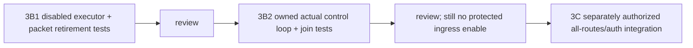

# MWOW-9 Stage3B — feedback executor / owned ENet loop contract

READONLY design checkpoint over `9d85b32408587757741dd0b3d8cb651d5552d42c`.
Stage3A accepted; this document authorizes no code/build/runtime. Continues only
[Stage3 plan §4](MWOW9-stage3-ingress-plan.md#4-реальный-enet-feedback-executor).
Confidence: 98% source/lifetime analysis; proposed interfaces require code review.

## 1. Reuse and obstacles, pinned at this base

| Actual source / ranges | Reuse or required delta |
|---|---|
| `control/input_seat.hpp:19–39,81–130`; `.cpp:29–89` | Real PeerToken, GrantHandle, SeatFeedbackRouter, FeedbackReservation. Intake stamps grant/device; peer/connection/binding are inside immutable grant. `reserve_send` increments `sends`, pops one item, max one outstanding. No second protected outbox. |
| `control/input_seat.cpp:13–27,125–181`; `sessions/input_handoff.cpp:146–207` | Revoke closes admission/purges queued effects. Neutral waits `!sends`; poll also waits input, send, exact saved ConsumerDrainTicket and F12 admission cleanup. Lost reservation ack keeps fence closed. Neither class changes in 3B1. |
| `control/control.hpp:29–45`; `.cpp:126–187,203–220,247–291` | Existing ControlPeer is a retained revocable sender identity; keep ABI and legacy `.send` unchanged. Current PeerState/Outbox/current/forget are local to run_control and cannot be safely borrowed by another thread. 3B2 moves ownership into one loop State, not a global registry. |
| `control/control.cpp:75–89` | Private `send_packet` returns queue acceptance only, hides packet lifetime. It cannot implement protected retirement by wrapping its bool. Leave legacy function in 3B1; new owner adapter calls actual ENet packet/send primitives directly. |
| `moonlight/control.hpp:316–337,375–402,556–584` | Reuse packed 14-byte ControlRumblePacket and existing header-static encrypt_packet; no crypto extraction/ABI change needed. Explicit little endian fields, unused field zero, V2 host direction only. |
| `moonlight/control_crypto.hpp:26–55,60–123`; `control.cpp:134,177–184,266–273` | Reuse the SAME loop-owned ControlKeyRegistry keyed by decoded 16-byte key, capacity1024/no eviction, replay1024, reserve_sequence before encryption; reconnect does not reset. No executor-owned key/replay/nonce registry. |
| `control/input_handler.cpp:21–36`; `tests/testControl.cpp:98–159,283–299` | Existing rumble construction/packed wire and V2/nonce/replay tests are references, not a route to protected legacy callbacks. Preserve these files/tests. |
| `wolf.cpp:177–180,217–220,247–276`; `control.cpp:16–50,161–195` | Current init is explicit; control thread detached, while(true), private host deleter, no stop/join. Owned loop is required before live protected sends. It changes shutdown semantics; not a claim of globally unchanged legacy lifecycle. |

ENet pin `44c85e16279553d9c052e572bcbfcd745fb74abf` (cgutman/enet,
`src/moonlight-server/CMakeLists.txt:87–99`) verified against local fetched source:
`packet.c:19–67` copies data (without NO_ALLOCATE), freeCallback precedes free(data)
and free(packet); `peer.c:92–117,185–225` success transfers ownership, failure leaves
caller owning; `peer.c:258–275,316–343,507–528` reset releases queues, disconnect_now
also flushes; `protocol.c:267–282` last reliable release marks SENT then frees;
`host.c:140–165` destroys socket, resets peers, frees host. SENT is not client rumble
consumption. `callbacks.c:9–62` uses malloc/free/abort defaults: packet tests need no
ENet initialization, but real ENet OOM may abort, not return typed Unknown. No claim
of fixing that inherited allocator limit; no global callback override in tests.

## 2. First increment 3B1: one disabled executor, no worker/route

Recommended new `control/protected_feedback.{hpp,cpp}`. Reuse actual Stage2 objects,
no parallel authority model. One executor belongs to the existing one-seat domain;
constructor has no ENet init/host/socket/thread/device side effect. Owner thread is
bound explicitly once. No raw ENetPeer in callbacks, queues or cross-thread handles.
Illustrative internal header signatures (names subject to implementation review):

```cpp
struct OwnerPeerView; // noncopyable owner-stack view, never an async payload
// exact retained PeerToken, ControlPeer identity, StreamSession, ControlKeyState&,
// current GrantHandle/device; raw ENetPeer& visible ONLY inside owner operations.
enum class SendState { Idle, Reserved, CallerOwns, EnetOwns, ReleaseSeen,
                       Cleaning, Retired, Unknown };
enum class ReleaseOutcome { SentReleased, CancelledReleased, FailedReleased, Unknown };
struct FeedbackStatus; // immutable value: phase, occupied, outcome, exact identities
struct EnetFunctionTable; // typed operations + retained dependency owner, see below
class PeerLease { // bounded owner-minted sidecar, contains NO raw peer
public:
  bool request_close(const ConnectionScope&, const PeerToken&) noexcept;
  bool closing() const noexcept; // atomic notification, not GameACL/serial grant proof
};
struct EnetFunctionTable {
  std::shared_ptr<void> dependency_owner; // immutable, not a back-reference to LoopState
  ENetPacket* (*create)(void*, const void*, size_t, enet_uint32);
  int (*send)(void*, ENetPeer*, enet_uint8, ENetPacket*);
  void (*destroy)(void*, ENetPacket*);
  // 3B2: typed service/reset/flush/disconnect/destroy_host operations, same boundary.
};
class EnetOwnerCalls { // owner check + private nested call-frame accounting
public:
  // State owns this before executor; no arbitrary public completion notification.
  explicit EnetOwnerCalls(EnetFunctionTable);
  OwnerBindResult bind_current_thread(); // once, explicit, no network initialization
  // service_once/reset_exact/stop_host are owner-only 3B2 wrappers, not raw handles.
};
class ProtectedFeedbackExecutor {
public:
  // Dependency owners prepared before publication; one preallocated retirement cell.
  ProtectedFeedbackExecutor(std::shared_ptr<InputSeat>, EnetOwnerCalls&);
  PumpResult pump_one(const OwnerPeerView&); // owner only, actual crypto/send path
  FeedbackStatus status() const;            // no raw peer, no completion-by-absence
private:
  friend class EnetOwnerCalls;
  void retire_ready(); // only after outer ENet/frame exit + owned payload cleanup
  static void packet_released(ENetPacket*) noexcept; // mark cell only
};
```

OwnerPeerView is produced only from real authenticated loop PeerState: successful
existing decrypt/structure/replay checks, current generation and owners mapping.
Validation reuses actual same_control_generation on retained associated/current
session snapshots; numeric lookup alone is never authority. Real CONNECT minting
and owners-map provenance are 3B2 work, not proved by the 3B1 fixture.
It carries no `bool wire_approved`. 3B1 software fixtures implement this trusted
owner seam; they do not prove live authentication/GameACL. A fresh `PeerToken::fresh(0)`
is minted for every actual CONNECT allocation (even identical ENet pointer/address/
client ID); token id is diagnostic, allocation identity authoritative. ControlPeer
remains the existing fresh-per-CONNECT shared identity, with token in the private
PeerState sidecar. A fresh peer on the same ConnectionScope still does not authorize
joint handoff/new consumers (accepted Stage2 rule). No public generation fields.

Pump algorithm, all I/O outside seat/queue/control locks:

1. Refuse wrong/missing owner or occupied/Unknown cell. Validate OwnerPeerView,
   current session/generation, exact grant/device, sender identity and V2/key_state;
   reserve the fixed cell before touching router. Missing owner fails closed via
   exact seat revoke; never pop a record and search another peer by numeric ID.
2. Call actual router.reserve_send immediately before encoding/encryption. Compare
   the returned immutable feedback grant/peer/connection/source/destination/binding/
   device with OwnerPeerView again. The gate linearizes reservation with revoke.
   Mismatch after reservation is terminal FailedReleased, not retag/relookup. Empty
   router is Idle only if no cell obligation exists; it is not a handoff ack.
3. Encode only standard rumble, selected grant slot0..15, low/high range0..65535
   validated (never wrap invalid integers). Reserve sequence from the existing
   authenticated key_state, then call real encrypt_packet(V2,host). Every reserved
   nonce is spent even if encryption/create/send fails. Exhaustion is fail closed;
   no wrap, retry with old seq or independent counter. Recheck exact peer retirement
   request before entering send; reservation already holds the gate fence if revoke
   raced after step2. A previously reserved operation may finish before the fence.
4. Actual enet_packet_create copies cipher bytes; NO_ALLOCATE prohibited. Set static
   freeCallback and cell userData before send; keep the cell strongly domain-owned.
   Translate actual send int to typed ownership: rejected→caller destroys via owned
   boundary; queued→ENet owns, never caller destroy. Exception with uncertain
   transfer→Unknown, retain cell, no speculative destroy/double free. Test hooks
   after a known transfer cannot erase that recorded ownership fact.
5. Packet callback only copies release flags/disposition to the preallocated cell;
   no ack, shared-owner destruction, allocation, lock, arbitrary callback or ENet
   reentry. `ReleaseSeen` is not Retired. All service/send/reset/flush/destroy calls
   capable of releasing packets must be enclosed by EnetOwnerCalls call frames.
6. At outermost return, after actual packet/data free and all call-stack frames,
   destroy attempt-owned cipher/plaintext/operation-hook holders outside all locks.
   Only then call reservation.retire(success), release its own reference outside the
   gate, and free the cell charge. Reservation/control identities needed for ack,
   domain-lived dependencies and arbitrary external owners are not payload cleanup
   obligations. No ownership inference from std::function copy or callback entry.

EnetOwnerCalls has private call-depth/frame accounting; no public `ack()` or caller
`after_stack()` assertion can forge completion. RAII only records frame exit;
explicit retire_ready runs after local owners have unwound, on both success and
catch paths. Proposed call-depth cap8 is checked before entry; overflow is Unknown,
not counter wrap. No arbitrary callback can create an unbounded recursive owner loop. Outer service/dispatch frame must be declared before received-packet
RAII and handler locals, so their destructors precede retirement scan. Nested reset
inside a handler cannot ack while the outer service/dispatch frame is alive.
The same logic is exercised by function-table calls, not a fake executor model.

Immediate RAII takes every caller-owned packet returned by create before any
throwing hook/holder work (F9 boundary). Before callback installation, explicit
caller destruction returning through the frame is release proof; after ownership
transfer, only the callback plus enclosing stack/cleanup can establish release.

Function table: create/copy packet, peer_send, packet_destroy; next increment adds
service, reset_peer, disconnect_now/flush and destroy_host. Defaults call pinned
ENet, no init. C-compatible raw calls + retained immutable operations owner; no
per-packet worker or owning std::function in a queue. Narrow internal attempt hooks
allow gates before/after reserve/encrypt/send/callback/stack-return/cleanup; hook
owners are released outside locks BEFORE ack, including exception paths. They are
injected synchronization, not completion evidence. Real packet destruction and
owned payload/destructor gates supply that evidence. A dependency owner lasting for
the whole loop is retired at loop shutdown, not falsely promised per packet.

## 3. Bounds, cancellation and exact fence

No extra protected outbox or popped batch: existing router cap256 + one in-flight
cell = **257 logical effect records maximum**, including ENet-owned/Unknown. Queue
items retain captured grant and never become a new peer's effect. Overflow uses
Stage2's existing close(true), reserved revoke independent of queue capacity.
No coalescing/replay of arbitrary effects. Step2 already bounds its queue; executor
reserves its cell/byte charge before pop, charge persists through cleanup/Unknown.

Proposed executor-domain logical owned-storage budget: 64KiB, charged using checked
`sizeof`/capacity arithmetic before allocation: 256 optional SeatFeedback records,
one reservation/cell/identity metadata, fixed14-byte plaintext, sizeof encrypted
object, max152-byte copied wire storage, ENetPacket and one outgoing command (actual
rumble wire38 bytes fits minimum MTU, no fragments), and attempt holder slots. Code
must assert this fixed layout fits; no claim of measured ABI sizes here. No dynamic
payload length accepted. Library allocator overhead/EVP workspace, retained grant
object graphs and legacy ENet queues are NOT a process RSS bound. No unbounded new
history: status keeps one current terminal record; old public handles are external
ownership. Fixed test hooks may retain fixture state; not a production memory cap.

Typed local outcome is distinct from delivery:

- SentReleased: normal ENet release + stack/payload retirement → retire(true),
  means safe local release only, not game/client acknowledgement.
- CancelledReleased: explicit trusted exact-old-grant revoke, owner resets that
  exact retired peer and observes release+stack cleanup → retire(true). This is
  intentional cancellation, never logged as delivered. No future send on token.
- FailedReleased: encode/create/send/ownership/transport error with proven local
  release → retire(false), preserving Stage2 quarantine semantics.
- Unknown: missing callback, unresolved ownership, stuck operation/cleanup/owner →
  no successful ack, retain occupied cell/domain; no replacement/retry capacity.
  Late proven release may retire(false) to finish cleanup, but terminal Unknown
  remains sealed and cannot reopen admission or auto-grant.

Trusted cancellation is not raw ENet disconnect authority. Cross-thread caller
first invokes exact InputSeat revoke/appropriate existing handoff closure, then
marks a preallocated per-peer retirement flag (no queued arbitrary payload). Owner
consumes it ahead of work and can call enet_peer_reset to abandon old retransmit
queues. Intentional reset is private transfer teardown, not GameStop/Leave or a
public takeover action. 3B1 only supplies/tests this seam; real routing is later.
Unexpected transport loss is a separate fail-closed outcome, not a new-owner grant.

After revoke, queued old entries are discarded; an already reserved send can finish.
Grant cannot publish while its reservation remains. Acknowledgement follows actual
local resources/ENet retransmit refs ending, THEN neutral may execute (current
input_seat.cpp explicitly waits sends==0), THEN exact saved ConsumerDrainTicket +
F12 admission cleanup + auth/binding revalidation allow coordinator commit. A stuck
send does not permit neutral/grant by assuming an empty queue. Revoke, auth-close
flagging, status/poll must still progress without waiting for owner cleanup; the
existing single5s decision may quarantine. Late retirement never auto-grants.
No lock held through callbacks/I/O/last payload release. Already-sent UDP, remote
client buffers/rumble and physical delivery cannot be recalled/proved by this fence.

## 4. Required next increment 3B2: owned actual loop

3B1 is independently testable but insufficient for enable. 3B2 must own the actual
existing loop, not start a second protected networking thread. Proposed opaque
`ControlLoopDomain` / `ControlLoopOwner` in new `control/control_loop.hpp`:
`start(config, sessions, bus, ThreadFactory) -> StartResult`, `request_stop() noexcept`,
`status() -> LoopStatus`, `join_when_exited() -> JoinResult` (owner only; Refused
until thread exit is known, Joined only after actual join). One allocated domain slot including
Unknown/start failure; no replacement loop or registry reset. Worker State owns
host, actual clients/owners, the SAME key registry and EnetOwnerCalls; executor is
optional/disabled. Strong State held by worker and domain, no State→thread-owner
cycle. No raw peer crosses threads; public notifications contain retained tokens.
PeerLease slots are bounded by actual host peer capacity (default20); Unknown slots
count and deny pointer-slot replacement. No internal historical lease list. Raw
peer/key_state pointers are owner-local borrows from State; a cell must not strongly
capture State and create State→executor→cell→State. Stage2 Seat/router have no back-
reference to loop. Public retained token handles are external ownership, not an
unbounded internal history cache. Status uses a short snapshot lock/atomic fields,
never waits for I/O or owner-thread dispatch. PeerLease close flag supplements,
not replaces, future serial candidate_gone/auth notification in the handoff gate.

Current private obstacles require narrow control.cpp changes: lift local
PeerState/Outbox/current/forget into owned State, keep exact MWOW-6 predicates and
key registry semantics; mint peer sidecar; wrap every actual ENet call (including
legacy send_packet, receive-packet destruction and free_host). Protected executor
must not be installed into existing sender routing before full owned-loop readiness.
Future real protected callback uses stable SeatFeedbackRouter, not ControlPeer.send;
ControlPeer remains the legacy API/identity. No ABI/global legacy crypto rewrite.

Start must publish readiness only after host/registry/owner identity exists.
ThreadFactory throw means no escaped thread (trusted all-or-nothing seam); returned
nonjoinable handle, host failure or exception closes publication, cleans unpublished
resources or reports Unknown if cleanup cannot be proved. Catch at worker boundary,
request exact closure, perform owner-only reset/drain, release callback/operations
owners and mark thread-exit readiness; actual join is final worker completion,
not a flag set before stack/TLS destruction. Prefer thread-exit future notification,
then owner join; test both completion and nonjoinable/rollback failures.

Stop is an out-of-band atomic request, never behind blocked payload cleanup. Owner
stops admissions, drains/discards queues, retires exact peers/packets via wrapped
reset/destroy, releases locals/dependencies, exits; supervisor owner joins. No join
on control/eventbus/HTTP/device callbacks. Missing/nonrunning owner, blocked external
call, failed join or deadline gives typed Unknown with strong domain retention;
no detach, forced cross-thread host close or destructor-based false completion.
5s is a decision policy, not physical driver/library/thread termination guarantee.

Minimum wolf.cpp delta: replace only control's detached launch with retained owner;
request its stop at shutdown, collect actual join before declaring control complete.
At deadline retain/log Unknown. Main must keep this owner alive and wait for eventual
exit/join rather than return and destroy a joinable thread; this may extend shutdown
indefinitely. That is an explicit control shutdown behavior change requiring review,
NOT a new generic process supervisor or a promise to stop all existing detached
HTTP/RTSP/mDNS loops. Those global ingress/process-shutdown limits remain separate.

## 5. Ownership, ordering and actual tests



Proposed **3B1 allowed paths**, for a new Manager code grant: new
`src/moonlight-server/control/protected_feedback.hpp/.cpp`, new
`tests/testProtectedFeedback.cpp`, appended isolated target in `tests/CMakeLists.txt`,
this scoped contract doc. Existing source glob suffices. No helper extraction from
crypto/input_handler/ControlPeer required; do not modify Stage2/3A or dependencies.
Safe fixture constructs real Seat + checked backend injected IO + real InputHandoff/
ConsumerRuntime Work seams. Link real ENet packet functions, never library init,
host/socket/main. Keep existing protocol and all safe assertions intact.

Proposed **3B2 additional paths**, separately reviewed/granted: new
`control/control_loop.hpp`, existing `control/control.cpp/.hpp`, exact control
startup/shutdown sites in `wolf.cpp`, scoped `tests/testControlLoop.cpp` + target/doc.
Private State/helper implementation can remain control.cpp; no broader extraction.
No input_handler/API/REST/RTSP/lobby/config/deps/DeviceExecutor/3A wiring ownership.

| Actual seam test | Required observable proof |
|---|---|
| Router capture→enqueue→pump, same raw peer reused with fresh PeerToken, wrong grant/device/connection/binding, missing owner, slot/extreme values | Real router/seat rejects stale identities; no encryption/send for invalid records, no retagging. |
| Real existing key registry + encrypt_packet | V2 host nonce bytes and exact packed rumble decrypt correctly; consumed nonce after failed encrypt/create/send; same key across peers continues seq; UINT32_MAX/exhaustion/cap1024 refuse. Old direction/replay tests unchanged. |
| Function-table production path wrapping real enet_packet_create/destroy, no init/socket | Actual callback enters before real free; gate callback and AFTER callback before destroy returns. Exact transfer remains Pending/Unknown until enclosing stack exit, cipher and owned hook destructor retirement; never infer release from marker alone. |
| Successful queue, failed create, rejected send, uncertain throwing transfer, reset/destroy, nested service frame | Exactly one ownership path; no double free, no ack on queued success or nested frame exit; exception paths retain/fail closed. Test actual raw packet, not another packet model. |
| Reentrant/blocking attempt cleanup and hook capture destruction | Outside seat/control locks; exact revoke/status/poll/auth-close progress. Reservation keeps neutral/grant blocked until release; teardown gates open even after assertion failure, all test threads join. |
| Queue256 + reserved1, byte reservation, overflow, missing callback/blocked owner | All occupied charge retained after pop/ENet transfer; revoke lane works; cap/Unknown denies replacement; fakeclock5s and late release never auto-grant. |
| Healthy drain vs explicit cancel vs send failure, real ConsumerRuntime ticket/F12 seam | Joint gate grants only after actual send retirement + checked neutral + exact saved ticket; FailedReleased quarantines; no unrelated producer/game stop. |
| 3B2 actual owned run-loop with fake host/service ops, real packet cleanup | Start throw/nonjoinable/partial init, stop before ready, exception/reset/shutdown, worker join and dependency destructor gates; no borrowed raw peer or thread escapes. Actual network integration remains unproved. |

No tests/builds performed for this document. Per-file SHA256, pinned ENet ranges and
callgraph evidence are in the thread report. Accepted Stage3A facts, Stage2/F12 and
MWOW-6 replay/cert guards unchanged. Inherited EAGAIN/noexcept/allocator limits,
legacy queue/global boundedness, RTSP response-buffer lifetime residual, all-routes/
singleton/prefix aliases, device readiness/reconciliation/kernel/Wine/isolation
remain gates. No WoW launch without new explicit permission; current game/prefix
untouched. Future physical tests prefer local games, not authorized by this plan.
