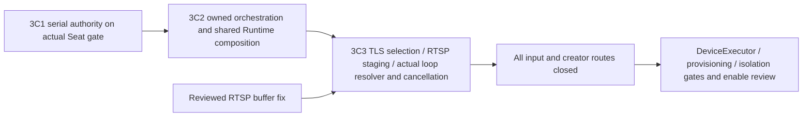

# MWOW-9 · Stage3C: proposed protected ingress integration

Status: **design checkpoint only; no implementation or enablement**. Base
`5398a49b5812ca5e954a86574e4744b8ec0bbf2a`, whole tree
`e5da8733953f823f225657e0d159c4d95908f1fc`, source tree
`61b1751026154be3c1abd9c3d0700d12df5909c7`. Role: game-complex. Confidence:
99% in the source constraints, 95% in the proposed split; handshake interoperability
and physical readiness remain unproved. This document grants no implementation ownership.

Basis: [Stage3 inventory](MWOW9-stage3-ingress-plan.md), [3B contract](MWOW9-stage3B-feedback-contract.md),
[Stage2/F12](MWOW9-input-seat-stage2.md), [3A facts](MWOW9-protected-access-stage3A.md).
Current primary-code ranges and SHA256s are in
[/checks/stage3C-plan/inventory.json](/home/bazzoozza/.bb/thread-storage/thr_z5wceyp8m4/checks/stage3C-plan/inventory.json);
the adjacent `source-ranges.txt` retains numbered excerpts. Of the earlier 45 source records,
39 are unchanged; this is an incremental integration contract, not a replacement inventory.
Normative requirements/decisions and both user-policy raw records are pinned there separately.

## 1. Current seams and the gaps they actually leave

Paths below are relative to `src/moonlight-server/`, except the explicit protocol path.

| Actual code at this base | Reuse / required change in a later grant |
| --- | --- |
| `sessions/protected_access.hpp:13–159`, `.cpp:191–347` | Exact DER, immutable evidence, bounded rules and fresh revisions exist. `is_current()` locks an independent store mutex: it cannot serialize a Seat grant with subsequent revocation. |
| `control/input_seat.hpp:84–106`, `.cpp:98–203` | Gate owns current/open/quarantine and bootstrap; the worker can open immediately after checked neutral. Protected authority must be installed **before** worker start, not attached after create returns. |
| `sessions/input_handoff.cpp:97–207,230–290` | Request saves the real old ticket while old is current; poll commits under Seat gate; actual Runtime admission and F12 cleanup accounting already exist. Validators are trusted callables, not a current TLS/GameACL authority owner. |
| `streaming/consumer_runtime.cpp:66–170,217–260` | Current is called under Runtime mutex and, in activation, under job mutex. It must never acquire Seat gate: Handoff already takes Seat→Runtime. Preserve accepted Runtime source/semantics. |
| `control/control_loop.cpp:110–206,371–478,550–600` | Real CONNECT mints PeerToken; current resolver and `owners` still use numeric session ID. Two same-client scopes cannot safely use this legacy resolution path. |
| `control/control_loop.hpp:43–93`; `control/protected_feedback.cpp:384–415` | PeerLease/attach_feedback exist; no protected candidate resolver or pending-transfer command exists. Healthy cancellation requires actual Pending handle/ticket and actual owner reset. |
| `rest/servers.cpp:99–182`; `state/config.hpp:42–76` | Paired TLS lookup returns a paired client, losing the presented-certificate object. Capture both exact leaves at the trusted TLS boundary; preserve existing verification. |
| `rest/endpoints.hpp:391–528`; `state/sessions.hpp:17–59,130–187` | Launch creates StreamSession; resume replaces registry before Stop; create_stream_session creates directories/random transport fields. None is a transport-only candidate constructor. ID lookup takes first match. |
| `rtsp/net.hpp:62–121,194–206`; `rtsp/commands.hpp:166–283` | RTSP selects a session per request, negotiates encryption then emits media events. Protected negotiation must precede key proof but cannot authorize a game. Async-write buffer lifetime is a separate unresolved patch. |
| `sessions/moonlight.cpp:241–299`; `streaming/consumer_events.cpp:7–51` | One private Runtime is created inside setup; media events directly admit, Stop/Pause discard returned tickets. Expose that same owned Runtime at composition, never create a shadow registry. |

## 2. One serial authority owner, not another permission model

Proposed new internal `ProtectedAuthorityDomain` owns one destination L, its exact catalog
binding, the private published facts, and an `AuthorityCell` guarded by **the existing Seat gate**.
No public gate/mutex accessor. New allocation identities cover domain, pairing, policy,
catalog binding, lifecycle and route binding; null is always denial. Numeric IDs, names,
prefix paths, PIN, pairing alone and first input cannot create a permit.
Ownership is acyclic: bundle owns Seat and authority facade; both retain Gate, Gate owns the cell
and sealed facts, but cell/permits retain only domain identity, never facade/worker/Seat backreferences.
The orchestration owner later retains this bundle; no Gate→orchestrator edge or worker self-owner.

The trusted TLS adapter retains the handshake's presented leaf and uniquely matching paired
leaf, runs existing verification, then uses the public 3A Principal/canonical DER primitives.
A captured pairing revision also must match the authority cell at commit. The adapter cannot
accept a wire `approved` bool, caller-selected paired record, or a certificate hash as authority.
Ambiguous paired records/numeric indexes fail closed. Exact DER follows any digest lookup.

Proposed internal signatures (names schematic; opaque arguments are not wire types):

```cpp
PreparedFacts prepare_facts(OperatorPolicy, VerifiedIdentityCapture, CatalogBinding); // outside gate
CloseResult close_exact(AuthorityNotice); // same Seat gate; no callbacks/IO/destruction wait
UpdateToken begin_update(OperatorCapability, ExpectedRevision); // closes before mutation
PublishResult publish_prepared(UpdateToken, PreparedFacts); // facts only; never opens Seat
SelectionPermit capture_selection(VerifiedIdentityCapture, ExactGameSelection);
// create_protected installs the cell and bootstrap permit before starting Seat's worker.
ProtectedSeatBundle create_protected(PreparedFacts, ProvisioningRecord, BackendFactory);
```

`PreparedFacts` owns a privately built AccessStore exposed only as const after publication,
plus its exact evidence/target. No surviving mutable store alias. Existing AccessStore parsing,
binding and evaluate/is_current operations run outside Seat gate while preparing that object.
Under gate the check is pointer/allocation identity equality against **owner-held published facts**,
current pairing/catalog/lifecycle/close sequence and exact candidate connection/peer. It does
not lock AccessStore or trust a caller's old snapshot. An old frozen store can still consider
its evidence current locally; the serial owner has already invalidated its authority globally.

Pair/unpair, ACL/config reload, app binding change and L lifecycle notification must first
call this owner. `begin_update` increments a checked monotonic command sequence under gate,
closes current input/feedback and pending selection, and reserves at most one update slot.
Overflow fails closed. Only then may a worker parse/write config or mutate legacy paired state.
Prepared completion must match its token, expected facts and latest close sequence; completion
of an older command cannot publish over a newer close. A later close always works even if the
update/cleanup slot is occupied. Failed persistence leaves the protected domain closed.
Unpair may close by exact principal across affected owned domains before its legacy mutation;
no global numeric-ID revoke. Raw peer notices carry exact connection+PeerToken, not operator power.

Publication of allowed facts never reopens a quarantined Seat or grants input. Stage2 has no
automatic quarantine recovery; policy replacement/terminal auth loss may therefore require
future explicit reconciliation even after facts become Allowed again. Do not promise live ACL
reconfiguration with seamless recovery in 3C1.

Protected bootstrap, request, poll/commit and prepared media admission all require the same
typed cell/permit check. Existing SeatValidation may remain an additional nonblocking condition;
`return true` cannot bypass protected authority. Initial grant and later handoff publish a
preallocated immutable route binding with the grant under the same gate. That binding retains
source S/T, destination L, connection, actual PeerToken, device generation and authority revisions.
Public Granted/status/evidence is historical inspection, never an admission capability.

F12 applies to facts/validator/route replacement too: prepare strong owners before gate;
exchange into an outer retirement owner; destroy after **all** locks. One bounded owned cleanup
slot remains charged through actual destructor completion and blocks a new grant, separately
from existing admission_cleanup_pending. A close only marks/invalidates retained records and
notifies; it must not drop a last arbitrary capture. Busy retirement cannot delay reserved close.
External shared owners are outside this acknowledgement. Use no detached cleaner/reaper.

Lock order: Seat→Runtime only where existing Handoff already requires it; never Runtime/job→Seat.
No Seat→AccessStore, command-queue→Seat, ENet frame→queue lock held across callbacks, or IO under gate.
Runtime Current reads a bounded immutable **transport-lifetime** snapshot, without Seat lock or
user callbacks; eligibility there is not permission. Retired snapshots contain only sealed data,
no arbitrary destructor callbacks; owner retention prevents last payload release under gate.

## 3. Selection and handshake without restarting the game

Existing HTTPS launch(appid)/resume on an already running protected L becomes a protected
branch **before** legacy create/resume. It requires the trusted current TLS principal and an
explicit exact-DER per-game operator allowlist. Pairing alone is insufficient. Resolve stable
GameKey↔catalog appid↔running L uniquely; title/path/prefix aliases are never authorization.
Launch's appid selects L; resume without appid requires the principal's unique retained protected
selection binding, otherwise denial, not lookup of an arbitrary running game by client numeric ID.
Proposed future config is operator-owned per-game exact DER pins (bounded canonical DER/base64),
not a new injection endpoint. Pairing remains an independent prerequisite. Parsing/installing
that configuration is a later owned patch, not part of 3C1.

The branch allocates only an immutable transport candidate: fresh ConnectionScope, transport
crypto state/correlators and source identity. A reconnect of S can retain S RunScope but needs a
fresh connection; a different source T gets its own logical source run, not a process. Destination
L/backend/producer do not change. Do not call create_stream_session, create folders, fire
StreamSession/StartRunner/PlugDevice, attach Wayland or copy legacy source device handles.

Keep a bounded protected transport table: current plus at most one candidate, including Unknown.
Do not append both same-numeric-ID records to `running_sessions` and hope first-match lookup works.
Its immutable lifetime view also serves the **same** ConsumerRuntime Current callback. Old remains
eligible until Handoff.request has saved its exact revoke ticket; only then may route publication
retire it. No fresh lookup/replacement of the saved ticket. Same numeric source identity can be
admitted anew only after old Runtime workers drain; its Busy rule remains intact.

Sequence (all transitions revalidate exact identities):

1. HTTPS authorized selection reserves the candidate/intent and returns existing protocol fields.
   Failure before transfer preserves the healthy old grant. Serverinfo/applist do not grant anything;
   protected applist visibility may filter disallowed games, but selection still rechecks authorization.
2. RTSP resolves that exact candidate by a unique server-generated existing correlator, once per
   request, retaining it through async work. No protected IP-only fallback, numeric first-match or
   caller-selected destination. Per-request binding is necessary: current server closes RTSP TCP.
3. ANNOUNCE validates/sets candidate V2 negotiation and stores bounded Audio/Video descriptions.
   It emits no start events, creates no pipeline, admits no consumer and cannot select another L.
   Repeated identical normalized ANNOUNCE is idempotent; conflicting replacement is refused.
4. Real CONNECT mints PeerToken; protected resolver associates it to the candidate without removing
   old current. Existing decrypt/tag/structure/input bounds/direction/replay and same key registry
   prove key possession. Only after ANNOUNCE can this proof use negotiated V2: do not wait for a
   granted consumer before allowing ANNOUNCE. A valid packet completes transport authentication,
   not GameACL authority and not first-input takeover. Pre-grant input is denied, not replayed later.
5. Owned orchestration requests Handoff with the captured permit, fresh connection **and** fresh peer,
   closes old admissions, saves old ticket, and posts exact owner cancellation (§5). After real joint
   fences and current authority checks, serial commit publishes grant+route. Staged media is then
   admitted serially through actual admit_prepared, never directly through legacy event handlers.

Protected ControlLoop insertion points: resolve CONNECT before `match_control_session`; use exact
protected lifetime membership in `current`; branch owner association before `owners[session_id]`
exclusion/publication; suppress legacy ResumeStream/input dispatch for the candidate; use protected
grant admission for input/IDR/termination and protected binding in feedback CurrentOwnerSource.
Legacy predicates remain unchanged for nonprotected sessions. One actual loop/key registry owns
both branches; no second decrypt/replay implementation, loop or caller-supplied PeerToken.
Existing `get_rtsp_ip_string` can return a real address: the protected response must use the unique
existing fake-IP session URL field, with actual client coverage before removing IP fallback there.

Retry correlation proposal: exact TLS principal + game/L/binding + normalized existing rikey/rikeyid
and negotiation fields maps to one server-minted internal intent; identical retry returns the same
pending/current receipt, competing intent is Busy. No public generation field. Keep one last/current
receipt; an expired/closed tuple cannot silently become a new selection. To bound older-key history,
propose protected-only fresh-key admission for a **new** intent using the existing owner-thread
ControlKeyRegistry (1024, no eviction), with a minimal read-only contains/newness seam before insertion.
Exact retained intent retry can reuse its reserved key; other already-seen keys are refused, not reset.
No parallel key history or nonce counter. This conservative compatibility restriction needs actual
Moonlight retry/reconnect tests before interop; it is not a demonstrated client behavior. Legacy
same-key reconnect counters remain unchanged. If client cannot supply a fresh existing rikey for a
new intent, keep enablement blocked and review correlation policy rather than add a wire epoch.

Proposed protected-only policy bounds, **unmeasured defaults**: one domain/current/candidate; two
staged descriptors (one per kind), ≤16KiB each and ≤64KiB total retained orchestration payload,
including popped work; normalized selection input ≤8KiB before copy. Prefer fixed-capacity descriptor
storage to make reservation before copy exact; dynamic capacity excess must refuse with owned rollback.
These are logical payload limits, not RSS or external dependency graph bounds. Facts use the separate
current 3A certificate/policy limits, not global wire restrictions.
One candidate setup TTL 30s; transfer's single monotonic 5s decision starts at request, never resets
per phase/retry. Expiry closes candidate, does not resume/grant automatically. Unknown retains cap.
Fresh existing-format RTP/ENet/fake-IP correlators require fail-closed CSPRNG and uniqueness checks
against current/candidate/legacy entries, with a bounded collision retry policy (proposed 8). They are
correlators, not authorization; unauthenticated RTSP resource exhaustion remains bounded denial.

## 4. Owned orchestration and real shared media lifetime

Propose one start-once `ProtectedRuntimeOwner` worker per domain, cap reserved before thread start.
Jobs are selection preparation, serial Audio/Video admission and owned retirement; no thread per
transfer. Max four fixed job cells (one preparation, two media, one retirement) share the 64KiB budget
including executing/Unknown jobs. Control cancellation/update slots are separately fixed at one each,
not unbounded bypass queues. Submission returns acceptance only. Popped work remains charged.
All long destructor/Work/validator cleanup runs outside ingress and locks. Existing Handoff supervisor
and Seat worker retain their roles; do not duplicate them in a parallel state-machine model.

`close_exact` is independent of the job queue and blocked worker. Pending target disconnect, TLS/
pairing/ACL/lifecycle close invalidates the same serial commit even if callback cleanup is stuck.
Worker allocation/start failure fails closed; uncertain start/exit retains domain cap, no replacement.
Stop is out-of-band; completion requires actual worker exit/join and retained cleanup retirement,
not a flag before TLS destructors. Owner destruction is lifecycle-only, never an HTTP/ENet callback.

Composition must create one shared ConsumerRuntime before registering any ingress; pass it explicitly
to moonlight setup and Handoff (small future dependency/return-bundle change, not a second Runtime).
Its Current view recognizes exact protected old/candidate lifetimes and existing legacy sessions.
Audio/Video Work retains source S/T scope plus producer L; preserve F6/F7 membership/producer guards,
and refuse missing/mismatched protected binding instead of falling back to source's producer.
The same source/run relationship required by Runtime::admit remains; L belongs in producer routing.
ANNOUNCE cannot bypass admit_prepared. Serial A then V avoids the one-slot F12 cleanup overflow;
failure after A is admitted revokes that exact candidate and retains actual ticket, no partial grant
success story. Input grant may precede media startup, but missing/failing media is not readiness.

The joint predicate remains actual input retirement + actual feedback retirement + checked 20-event
neutral for L/device + exact saved old ConsumerDrainTicket.complete + F12 temporary-admission cleanup
+ new owned-authority cleanup + current authority/binding/backend. Neutral is attempted after input/
send fences even if old consumers are stuck. No missing status/ticket or HTTP accepted is completion.
Late completion after 5s Unknown cannot grant automatically. No GameStop/Leave/restart of L.

## 5. Owner-thread cancellation, exact peer identity and feedback

Proposed bounded internal API on actual ControlLoopOwner:

```cpp
OwnerCommandResult request_transfer_retirement(std::shared_ptr<const TransferHandle>);
// Accepted/Duplicate/Busy/Stale/Unknown; never a packet-release acknowledgement.
```

Store one immutable pending command **including executing/Unknown**, carrying the real Pending
handle with matching saved ticket and exact old grant/connection/peer/device/L. Consume it before
normal sends/service on the same execution owner; raw peer is resolved only from that actual lease.
No stale raw pointer or numeric/current-seat lookup, and no cross-thread reset. Do not forget old
association before it can construct the exact OwnerPeerView for cancel_for_transfer. If that lease
already disappeared/reused and release is unproved, refuse/Unknown rather than reset the new peer.

Actual cancel_for_transfer→reset_peer→free callback→packet/data free→enclosing frame return→owned
payload destruction→reservation retirement remains mandatory. A no-active-reservation result only
means no operation; Handoff's actual send fence is still authoritative. Keep one outstanding send;
no protected fallback to legacy ControlPeer.send, which would bypass this accounting. An owner
command status/empty outbox is never a send fence. F13 scoped failure and F14 receive-cell reservation
remain unchanged; late old errors cannot seal/revoke a new grant or overwrite an uncertain packet.

Orchestrator retains the actual TransferHandle until owner operation/temporary references retire;
queue swaps/releases happen outside its mutex and Seat gate. Transfer validator captures must not
be last-released under queue/ENet-owner control locks. Lifecycle shutdown retains command/operations
owners until actual reset/drain/join; a stuck external call gives bounded Unknown decision, not
bounded physical termination. Reserved authority close does not wait on owner-command acceptance.
Disconnect/termination notices close only exact peer/connection authority. Raw disconnect is not
proof of send retirement and cannot confer GameStop or revoke a newer owner's unrelated grant.
HTTPS Quit captures the exact source selection/grant at ingress under the owner gate and retains
it through processing; ambiguous source identity is denied. A delayed old request cannot resolve
the new current grant later. Acceptance describes source-close request, not game termination.

## 6. Close every legacy bypass before any enablement

The earlier 45-file inventory remains the checklist. Required protected branches, not global changes:

| Route / creator | Closure and later actual test |
| --- | --- |
| `control/input_handler.cpp:738–801`, typed handlers `278–736` | Decrypted protected dispatch before helpers; allow selected wire slot 0..15 only, default0. Arrival is metadata; mask removal neutralizes selected pad, never creates/unplugs legacy devices. Deny keyboard/mouse/text/raw touch/pen/motion/battery/unsupported extensions and UI-combo actions before side effects. HUD touch may later become gamepad commands. |
| `api/endpoints.cpp:215–403,574–596` and typed/direct APIs | Protected input default-deny without explicit exact existing-grant delegation; held old requests cannot borrow current grant. Session/runner APIs cannot create a protected alias, attach devices or stop L via a legacy path. No new injection endpoint. |
| HTTPS launch/resume/cancel; RTSP ANNOUNCE/PLAY; Resume/Start media events | Branch before legacy constructors/replacement/event emission. Protected remote Quit closes source admission/consumers only; deny remote process stop absent separate operator authority. PLAY/HTTP success is not grant/drain proof. |
| `sessions/moonlight.cpp:62–169`, `state/sessions.hpp:115–187` | Source candidate cannot create Wayland keyboard/mouse, legacy pad/touch/pen, directories or runner. One persistent checked Xbox belongs to L, not S/T. |
| Lobby Join/Leave/UI-combo, producer switch and `sessions/lobbies.cpp:548–591` relays | No ordinary Leave/stop_when_empty for transfer; retain F6/F7 exact membership guards. Deny unauthorised protected producer switch/legacy join mutation rather than redirect to a raw-ID alias. Lifecycle end closes authority before releasing L. |
| PlugDevice/UnplugDevice queues, Docker runner and existing aliases | Exact target/device generation must belong to trusted provisioning inventory; event acceptance is not attachment or isolation proof. Protected unknown aliases fail closed. |

`ProvisioningRecord` must come from a fresh opt-in protected destination and exhaustive creator/
pending-command accounting, retaining L and backend generation. An empty held-input set or today's
three ProtectedInventory booleans is not proof. Future bounded DeviceExecutor must supply actual
attachment completion for runner/device generations; same-game/other-local-game isolation and
prefix aliases remain gates. A software fixture may inject a clearly labelled provisioning seam;
production cannot use a mocked-ready bool to enable the feature.

Separate prerequisite patch: `rtsp/net.hpp:194–206` must retain serialized response storage and
connection through async_write completion (e.g. captured immutable buffer + self), tested with
delayed completion/close/exception on the actual connection seam. No fix is applied here; review it
before protocol interop, preserving request bounds. Do not bury it in authority changes.

## 7. Smallest implementation increments and acceptance



**Recommend 3C1 only next.** Proposed exact ownership: NEW
`src/moonlight-server/sessions/protected_authority.{hpp,cpp}`, narrow
`control/input_seat.{hpp,cpp}` (cell/bootstrap installation), `sessions/input_handoff.{hpp,cpp}`
(typed authority check and grant+binding commit), NEW `tests/testProtectedAuthority.cpp`, appended
isolated target in `tests/CMakeLists.txt`, this document. No AccessStore/ConsumerRuntime/backend/
crypto/loop/endpoint change in that increment. Existing classes/tests retain nonprotected internal
behavior. These edits need Manager's concrete grant; they are not authorized by this plan.

3C1 is enforcement, not a second facts evaluator: tests drive real AccessStore DER primitives,
actual Seat/Handoff/Runtime and checked backend injected IO. Required cases: revoke on both sides
of final commit, old locally-current Evidence after owner close, stale operator completion, identical
values/new revision ABA, exact old peer notice versus new grant, bootstrap close during neutral,
auth/binding change while ticket waits, and blocking/reentrant retired validators with close progress
and no grant until owned cleanup ack. Keep original F12/F13/F14 cases/assertions. No fake Runtime,
parallel permission model or global allocator hijack; allocation/rollback gaps labelled honestly.

Split orchestration next because request/admit_prepared and destructors can block outside gate:
3C1 exposes only lifecycle-owner preparation and short serial-close methods, no ingress adapter.
3C2 proposed paths: NEW `sessions/protected_runtime.{hpp,cpp}`, scoped `sessions/moonlight.cpp`,
`sessions/handlers.hpp` and `wolf.cpp` registration sites only as needed to share Runtime,
plus safe fixture/target. Test actual
blocked Work cleanup, queue+inflight limits, reserved close, real ticket saved before route retirement,
registry pruning, serial Audio/Video, deadline/Unknown and actual worker exit/join. No runtime enable.

3C3 needs separate ownership grants for `rest/servers.cpp,endpoints.hpp`, `rtsp/commands.hpp,net.hpp`,
`control/control_loop.{hpp,cpp}`, pairing/lifecycle mutation callers and scoped composition/tests.
The minimal existing-registry contains/newness helper, if accepted, is separately scoped to
`src/moonlight-protocol/moonlight/control_crypto.hpp` and existing crypto tests; no cipher changes.
Actual-handler/decrypted-dispatch tests must cover paired-but-not-allowed, altered DER, aborted
handshake, unauth RTSP, ANNOUNCE-before-key-proof, same client/two scopes/key resolution, duplicate/
expired/conflicting retries, caps, disconnect/auth races and no legacy creator/event calls. Actual
loop fixtures exercise real Pending transfer cancellation/packet retirement, not a mocked success ack.

Final route tests enumerate every input variant/direct helper/API and creator, retain all MWOW6
cert/V2 replay/nonce/bounds, MWOW7 Unknown and F6/F7/F12/F13/F14 checks. Persistent L/backend identity
must survive S→T with no unrelated producer stop. Missing route/provisioning proof keeps feature
disabled. Full exception-safe ingress, allocator/EAGAIN/noexcept, global bounded shutdown,
all-route singleton, prefix aliases, reconciliation, kernel/Wine delivery and physical isolation are
not established here. Remote process-stop UI is not needed: default deny; product decision only if
that capability is later requested. No new UI before Penpot. WoW must never launch without new
explicit permission; current game/prefix untouched, future physical trials use local games after
separate software/permission gates. No build, runtime, device or heavy slot was used for this plan.

## 8. 3C1 implementation checkpoint (disabled; independent review pending)

Manager's subsequent grant authorizes the nine scoped paths, not §3–6 ingress wiring.
`protected_authority` now seals private 3A stores, mints internal typed permits and owns a cell on
actual Seat gate. Operator updates close before versioned publication; publication cannot recover
quarantine. The protected factory installs cell/bootstrap data before backend callbacks/worker start.
Actual Handoff request/poll/admission and bootstrap require typed authority; default internal Seat
behavior remains separate. Protected additional validators execute outside gate and are not authority.
Retirement scopes cover actual replacement owners and accepted request/bootstrap validator temporaries;
sealed historical evidence/permits carry no arbitrary resource callback. A provider RetirementResource
is an optional trusted lifecycle seam: retirement/destruction outside locks, throwing retirement retains
Unknown capacity. It is not a device delivery or TLS proof. No new worker or ingress is introduced.

Code-level failure checks and native evidence will be recorded separately before this checkpoint is
submitted. Initial implementation is not a PASS claim. Allocation failure before gate is source-audited,
not globally fault-injected. Fact/update/permit APIs are trusted C++ capabilities, not unforgeable public
network credentials. Retry/key policy, real TLS provider, provisioning/readiness and all subsequent
orchestration/route work remain proposed only. WoW/game/prefix/device restrictions are unchanged.

3C1 concrete ownership/limits: sealed Facts use a private const AccessStore behind implementation
storage, so standalone Seat fixtures acquire no new crypto link dependency. Gate retains current,
bootstrap and pending sealed permits; provider resource/callback ownership is separate and never
enters historical Evidence/route handles. One authority cleanup slot includes Unknown; no cleaner
thread. `RetirementResource::retire()` may fail; its actual owner stays retained in the domain, with
no retry/replacement or healthy ack. Final lifecycle destruction must itself safely own any external
resource completion; this interface does not prove bounded physical teardown. Facade destruction
closes retained Seat before releasing members outside gate. Active callers must retain their facade;
concurrent destruction of an object being called is outside the C++ ownership contract.

Operator counter exhaustion is sticky and denies late publication even when its last pending token
has the same maximal sequence; the occupied update remains retained. Bootstrap route publication
occurs only with successful checked neutral, typed validation and listener health. Additional protected
validators may inspect Seat outside gate but must keep their existing nonblocking invocation contract;
blocking destructor retirement is accounted independently. Invalid/refused unpublished inputs release
outside locks but do not acquire permission or an effectful admission cleanup obligation. No full
allocation-fault injection claim: pre-gate allocation rollback and sealed-data releases are source proof.
Detailed commands, failures, preservation and final validation are recorded in
[3C1 report](/home/bazzoozza/.bb/thread-storage/thr_z5wceyp8m4/report/MWOW9-stage3C1.md).

## 9. F15: shared validator invocation reservation

Protected prepared admission now checks exact Granted/current/connection/peer/typed authority under
Seat gate before invocation, and reserves the same single authority cleanup slot used by protected
poll. Occupied means Capacity without a second callback or current-grant quarantine. The actual retained
TransferHandle owns the same callable throughout outside-lock invocation; no std::function copy is used
as synchronization. Under-gate identities/health/authority are checked again before real Runtime admit.
The invocation reservation remains occupied through actual Work/hook/handle temporary destruction and
F12 admission retirement; acknowledgement occurs outside their cleanup, not before it. Close, neutral
and pending deadline checks remain independent. Pending/stale admission never invokes the callback.

Audit: protected poll already reserves this slot before invoking its retained Pending handle; request's
by-value actual validator runs before that callable is published into a TransferHandle; bootstrap owns
its separate initial validator before open. Legacy request/poll/admission continue serial invocation under
their original gate. Aliasing mutable state through distinct externally supplied callbacks is not made
thread-safe by this contract. No new gate field/worker, Runtime/Seat/AccessStore/crypto/loop/ingress change.
Two deterministic actual coordinator regressions use atomic entry counts/gates, not concurrent unsafe
mutable state: premature Pending admission and overlapping Granted Audio/Video attempts, including
close/revalidation and deadline progress. Their bytes are identical between semantic RED and GREEN.
F15 evidence/report: /home/bazzoozza/.bb/thread-storage/thr_z5wceyp8m4/report/MWOW9-F15.md.

## 10. 3C2 implementation checkpoint (disabled internal composition)

Concrete ownership: ConsumerComposition owns one real ConsumerRuntime and a data-only atomic
snapshot of at most two exact transport ConnectionScopes. Its Current combines that snapshot with
the unchanged running_sessions exact-scope predicate; no Seat/authority/queue lock or user callback.
Wolf constructs only this composition before handler registration. The compatible three-argument
moonlight setup delegates to the explicit-runtime overload; Wolf uses the explicit shared instance.
No protected owner/Seat/game is constructed by Wolf.

ProtectedRuntimeOwner is a start-once lifecycle object, reserved before bootstrap/thread launch;
it retains the actual authority/Seat/Handoff bundle and the same composition. A single worker runs
request and Audio/Video admit_prepared serially. Four fixed cells (preparation/audio/video/retirement)
retain queued, popped and Unknown obligations. Inputs transfer unique ownership (no callback or byte
copy at submission); sizeof(job), vector/string capacity and fixed-cell overhead count against 64KiB.
External capture graphs, dependencies, thread stacks and allocator overhead are not RSS-bounded by
that logical budget. Refused inputs are destroyed outside locks. Cell identity/charge survive all
payload destruction, including reentrant cleanup; Unknown retains its cell and forbids replacement.

Queue mutex never nests Seat/Runtime/authority calls or arbitrary destruction. Execution moves a
payload out while retaining its charged cell; publication moves retired diagnostic owners out before
unlock. close_exact and stop are out-of-band, independent of blocked execution/cleanup. Existing
Handoff owns the five-second decision and exact saved ticket; no copied permission state or new
transfer deadline. Old lifetime can be pruned only after exact saved-ticket capture. Media payloads
must bind source connection/peer to the actual handle and producer to destination L. Failure closes
that exact candidate and retains its real revoke ticket, never claims partial media readiness.

Thread exit uses notify-at-thread-exit future plus actual join, not an early returned flag. Factory
is trusted all-or-nothing; failed/nonjoinable launch consumes the start-once cap. Destructor is
lifecycle-only, can wait indefinitely on blocked user cleanup, and cannot run on its worker/callback.
Prepared callbacks/Work are trusted internal seams; actual Gst work construction, loop cancellation,
TLS/candidate/ANNOUNCE routing and enabled readiness remain 3C3/later gates. Tests use real classes,
DER facts and injected checked IO, with no game/device/network runtime.

3C2 refinement: diagnostic transfer storage is weak; actual Handoff alone retains its current
validator. Preparation and media phases refuse overlap while either cell is charged (queued,
executing, destructor retirement or Unknown). Thus no orchestration-owned old media/handle can
outlive F12 cleanup into a later request. There are four fixed cells, with at most preparation+
retirement or audio+video+retirement simultaneously occupied; refusal is Busy without effects.
Direct scope string capacities (≤256 each), correlation IP capacity (≤256), vector capacity,
job/receipt and fixed-cell sizeof are charged. Allocator overhead/external callable capture graphs
remain explicitly excluded; caller prepares payload off ingress, submission transfers ownership
without copying it. Raw runtime access is composition/diagnostics, never protected admission authority.

Manager-approved narrow expansion: `InputHandoff::poll_deadline()` checks only the existing Pending
handle/started/clock under its existing Seat gate and quarantines on exact five-second expiry,
backward clock or clock exception. It never invokes validator, Runtime, IO, grants or releases
payload. Clock remains trusted nonblocking/nonreentrant. Owner status calls this BEFORE queue lock.
This proves a responsive decision WHEN status/tick runs while a validator is blocked; it does not
prove autonomous notification within five seconds when every caller is idle/blocked. 3C3 periodic
caller integration is still missing. Existing poll/F15 reservation behavior is unchanged.

Final lifetime boundary: start and destruction are single lifecycle-owner operations, not concurrent
with facade calls; no facade publication before start returns. The worker's exit future covers actual
thread/TLS exit; Joined means orchestration thread joined, NOT shared ConsumerRuntime/all media or
all retained Unknown resources retired. The composition remains retained independently. Startup
failure and Unknown consume its protected-owner slot permanently. Shutdown close uses retained exact
operator/facts capability and covers Pending/bootstrap even when `seat.current()` is empty.
Four cell indices use a fixed FIFO; queued/executing/retained failure payloads remain charged until
actual destructor return (Unknown stays charged). Failed media exceptions revoke the captured exact
candidate and retain its ticket when available; a missing/throwing revoke never proves release.
Old transfer diagnostics are weak so they cannot extend an owned validator past real Handoff's
retirement fence. External diagnostic/caller owners remain outside that completion claim.

Software evidence and exact stack/queue IDs are recorded in the new report
`/home/bazzoozza/.bb/thread-storage/thr_z5wceyp8m4/report/MWOW9-stage3C2.md`.
Earlier reports/raw artifacts are immutable. No protected runtime construction/enabling in Wolf,
no actual media descriptor-to-Gst adapter, no Loop cancellation/TLS/ANNOUNCE/selection integration,
no bounded DeviceExecutor/readiness/singleton/reconciliation/physical proof is claimed. WoW requires
new explicit permission; current game/prefix untouched; future local-game tests are a separate gate.
